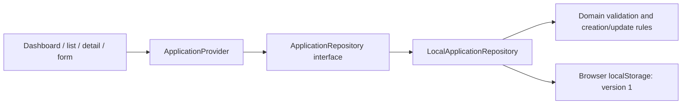

# Architecture

## Confirmed decisions

The tracker is an additive pnpm workspace slice in the existing Nx monorepo. The existing client, Angular admin, Nest API, shared libraries, and CI workflow are preserved. The Next.js 16 App Router app uses React 19, strict TypeScript, Tailwind CSS 4, and small reusable native components. A Radix dialog provides accessible focus management and modal semantics; Lucide provides consistent icons. No backend or external service is created.

```text
apps/web/src/app          Routes, layout, global tokens/styles
apps/web/src/components   Shell, views, provider, reusable UI, job form
apps/web/src/lib          Local persistence adapter
libs/domain/src          UI-independent application model and rules
tools/job-tracker/tests/unit  Domain and persistence contract/failure tests
tools/job-tracker/tests/e2e   Real browser journeys on desktop/mobile
tools/job-tracker            Nx quality targets and isolated test tools
```

The `@fats/domain` workspace package exports TypeScript source; Next transpiles it through `transpilePackages`. A standalone package build is unnecessary for this private workspace. Explicit package scripts and Nx quality targets keep the initial dependency footprint smaller than multiple generator/executor plugins. The framework plugin can be added when its generators or task inference become useful.



Routes render inside one application provider. The provider loads after client hydration, reports loading/errors explicitly, and refreshes from the repository after successful writes. All views derive from that collection. A `storage` event refreshes other tabs; the adapter reads the current collection before each write.

`ApplicationRepository` exposes asynchronous `list`, `create`, and `update` methods. The adapter can later become an HTTP implementation without changing the model or view behavior. The provider accepts an injected repository. A future backend will still need authentication, authorization, migrations, conflict policy, and durable error semantics; this interface is not a claim that backend work is already done.

## Model and persistence

An application has a UUID, title, company, source URL, location, description, status, and creation/update timestamps. New records start Saved. Updates preserve identity and creation time. Validation trims text, enforces required fields and length limits, and accepts only complete HTTP(S) URLs without embedded credentials. Descriptions render as escaped plain text; links open with `noopener noreferrer`.

Storage key: `fats.applications.v1`. Shape:

```json
{ "version": 1, "applications": [] }
```

Stored records are validated before use, including IDs, dates, statuses, required details, and safe URLs. Unknown versions, malformed records, or duplicate IDs cause a visible read error. Nothing is automatically cleared or overwritten. Failed writes reject; the previous persisted state and current form remain available. There is no silent in-memory fallback that pretends a write survived a reload.

For developer-assisted recovery, first back up the raw site storage value privately using browser developer tools. Inspect the version and record schema against the adapter, and repair a copy before replacing data with the user's authorization. Never paste real job notes into shared logs or delete the original as a diagnostic step.

## Tooling decisions

- pnpm 11.27.0, Node 24 LTS; exact direct versions and a lockfile.
- The existing Nx 23.1.1 orchestration remains in place. Tracker packages pin Next 16.4.0, React/React DOM 19.3.1, and Tailwind 4.3.3 independently of legacy app versions.
- TypeScript 5.9.3 satisfies the installed TypeScript ESLint supported range (`<6.1`). Latest TypeScript 7 is outside that range.
- ESLint 9.39.5 is the compatible major for the installed Next React/import/accessibility plugins. Its upstream support has ended; upgrading the lint stack when those plugins support ESLint 10 is a tooling follow-up. No incompatible peer versions are forced.
- Tracker lint uses its local Next flat presets and restricts UI imports in the domain. Existing root lint configuration remains unchanged. Prettier handles formatting.
- Vitest 5 tests rules and adapter behavior without UI dependencies. Playwright tests browser persistence and responsive interactions. Test dependencies are development-only.
- pnpm's build-script allowlist is explicit (`allowBuilds`); only required native/tool packages may build. Exact recent package exemptions in the workspace were generated by pnpm's release-age policy.

## Assumptions and limits

Browser storage is acceptable for a development vertical slice, not a hosted production system. It is synchronous internally, origin-scoped, bounded by the browser, and vulnerable to site-data deletion. Read-before-write reduces stale sequential updates but does not make simultaneous cross-tab writes transactional; the last write can win. Offline capture, conflict resolution, migrations between schema versions, exports, and account security remain future work.

No bundled remote font is needed: the typography stack falls back to locally available Segoe UI/Arial. No CI service, cloud cache, container, database, secret, or deployment is added.

The development origin allowlist adds only `127.0.0.1`, so browser tests and local previews can use the loopback IP with the normal `pnpm dev` command. Next already allows `localhost`; broad hostname wildcards are unnecessary. Browser storage remains separate for each origin.

## Official references checked

- [Nx with Next.js](https://nx.dev/docs/technologies/react/next/introduction) and [starting an Nx workspace](https://nx.dev/docs/getting-started/start-new-project).
- [Next.js App Router](https://nextjs.org/docs/app/getting-started) and [Next.js 16 changes](https://nextjs.org/docs/app/guides/upgrading/version-16).
- [Development origins](https://nextjs.org/docs/app/api-reference/config/next-config-js/allowedDevOrigins), also checked against the installed Next.js documentation under `apps/web/node_modules/next/dist/docs/`.
- [Tailwind's Next.js integration](https://tailwindcss.com/docs/installation/framework-guides/nextjs).
- [Radix Dialog](https://www.radix-ui.com/primitives/docs/components/dialog) and [shadcn's Radix dialog pattern](https://ui.shadcn.com/docs/components/radix/dialog). The small local wrapper follows this composition without adding unused generated components or a CLI runtime dependency.
- [pnpm 11 settings](https://pnpm.io/settings).
- [Playwright web server configuration](https://playwright.dev/docs/test-webserver).

Registry versions and installed peer metadata were also checked. The lockfile is authoritative for this workspace.
